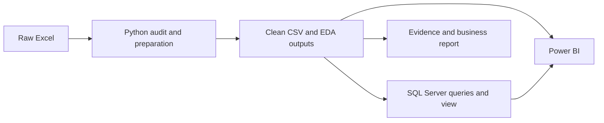
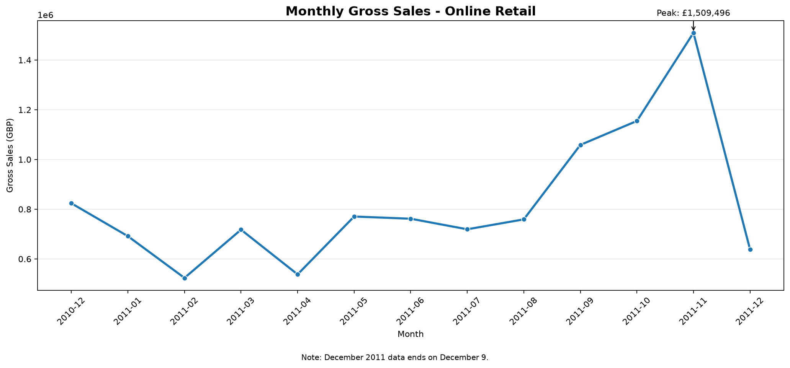
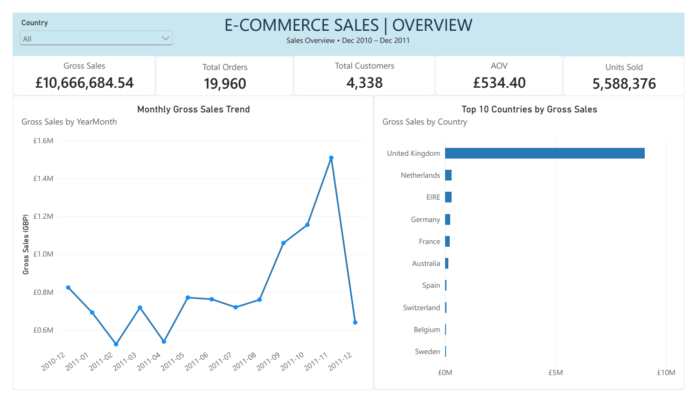
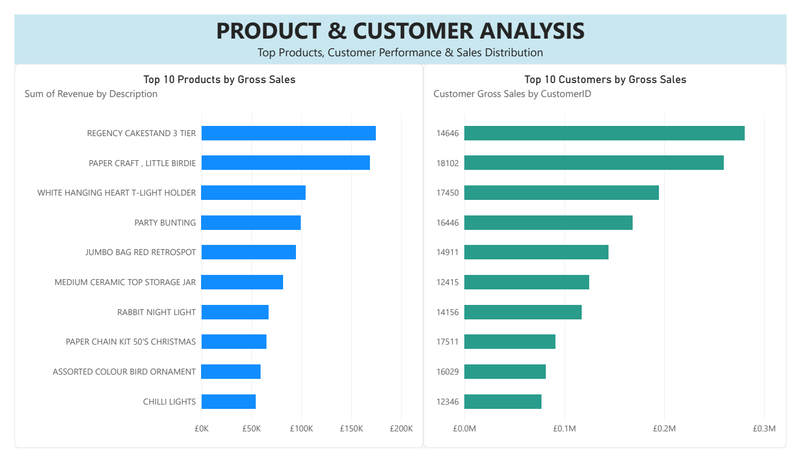
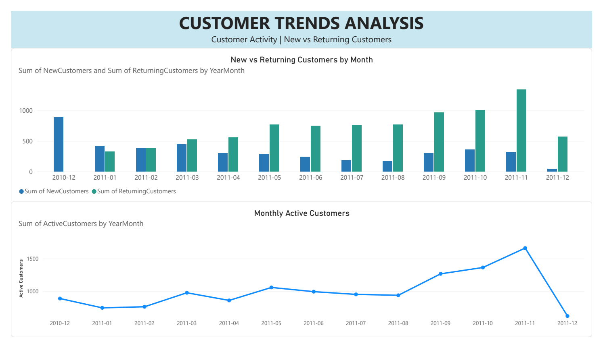

# E-commerce Sales Analysis

**Python · SQL Server · Power BI · Business recommendations**

An end-to-end analysis of UCI Online Retail transactions, from source-data audit to a three-page Power BI report. The project asks where recorded sales come from, how activity changes over time and which product/customer rankings require further investigation.

**Read the [business report](reports/business_insights.md)** or the [PDF edition](reports/business_insights.pdf). See [validation status](docs/validation_status.md) for verified calculations and remaining dashboard limitations.

## Business problem

A retail team needs a consistent view of sales trends, geographic concentration, products and customers. The analysis supports inventory planning, account review and repeat-purchase investigation. It explicitly separates positive sales activity from net revenue after returns.

## Dataset and headline results

Source: [UCI Online Retail](https://archive.ics.uci.edu/dataset/352/online+retail), Chen (2015), [DOI 10.24432/C5BW33](https://doi.org/10.24432/C5BW33), CC BY 4.0. All values are **GBP**, covering **1 December 2010 to 9 December 2011**.

| Metric | Value |
|---|---:|
| Raw transaction lines | 541,909 |
| Eligible sales lines | 530,104 |
| Gross Sales | £10,666,684.54 |
| Distinct sales invoices | 19,960 |
| Identified customers | 4,338 |
| Units sold | 5,588,376 |
| Average order value | £534.40 |

One row is an invoice line. Gross Sales is `SUM(Quantity × UnitPrice)` over eligible sales lines. AOV is Gross Sales divided by distinct InvoiceNo. Customers exclude missing IDs. December 2011 is incomplete; yearly totals are not comparable full years.

## Tools and workflow



- **Python:** pandas, NumPy, openpyxl, Matplotlib and seaborn.
- **SQL Server:** aggregations, CTEs, LAG, ranking and cumulative contributions.
- **Power BI Desktop:** three report pages using transactions and summary sources.
- **Excel:** original source workbook. No separate completed Excel analysis deliverable is claimed.

## Data cleaning and preparation

Notebook 01 audits nulls, exact duplicates, cancellations, prices, quantities and dates. It normalizes invoice identifiers, classifies transactions and retains rows with a non-cancelled invoice, positive quantity, positive price and valid invoice/date. Revenue and Year/Month/YearMonth columns are added.

Missing CustomerID is retained for aggregate sales and excluded from customer analysis. **Exact duplicates are retained in the established baseline.** The 5,226 repeated rows in the sales dataset contribute £24,573.74 in a deduplication sensitivity. A stable source line ID is unavailable, so a changed deduplication policy needs an explicit business decision.

Notebook 02 creates monthly, country, product and customer summaries, checks reconciliations, examines two large sale/cancellation pairs and exports a SQL-compatible CSV. Product ranking excludes `DOT`, `POST`, `M` and groups exact StockCode + Description pairs. The overall sales KPI uses all eligible lines.

## Exploratory analysis



The five saved EDA charts cover monthly revenue, monthly growth, products, countries and customers. They can be regenerated from notebook 02. Calculations and material claims are independently reproduced by `scripts/build_evidence.py`.

## SQL analysis

Eight analysis queries cover monthly sales, top products, country sales, top customers, MoM growth, annual totals, customer activity and product contribution. Setup scripts, a reusable monthly customer view and reference KPI queries are provided in [sql/README.md](sql/README.md).

## Power BI dashboard

Open [ecommerce_sales_dashboard.pbix](powerbi/ecommerce_sales_dashboard.pbix) in Power BI Desktop. Imported data supports viewing without a database connection; refreshing requires updating the SQL Server and CSV source settings.

| Page | Contents |
|---|---|
| 01 - Sales Overview | Five KPIs, monthly trend, country sales and Country slicer |
| 02 - Product & Customer | Top 10 product and identified-customer charts |
| 03 - Customer Trends | New/returning customers and monthly active customers |

See [dashboard notes](powerbi/README.md) for source mapping and image previews. Country interactions across summary tables have **not** been certified. The top-product CSV and monthly customer view lack country-level detail; joining them to transactions cannot recover that missing detail.

### Report previews

Native Power BI exports, with Country set to All. [Download all three pages as PDF](powerbi/ecommerce_sales_dashboard.pdf).







December 2011 covers only the first nine days. Product/customer values are gross and may include sales later reversed. Returning-customer share is not cohort retention.

## Business insights

1. **November peak:** £1.51M Gross Sales, 30.69% above October; one annual cycle does not prove recurring seasonality.
2. **Market concentration:** UK contributes 84.61%; overseas totals should be assessed alongside account concentration and costs.
3. **Product ranking caveat:** two large sales worth £245,653.20 have equal cancellations in the raw source; Gross Sales overstates net demand for those examples.
4. **Account concentration:** the top 10 identified customers contribute 17.26% of identified-customer Gross Sales, with some accounts affected by exceptional cancellations.
5. **Repeat activity:** 1,341 of 1,664 active identified customers in November were previously observed, a share of 80.59%; this is not a cohort retention rate.
6. **Coverage:** missing CustomerID accounts for 16.46% of Gross Sales, limiting customer-level conclusions.

## Recommendations

Reconcile returns before inventory/account decisions, define duplicate handling, investigate capacity around the observed peak, assess overseas margin and concentration, and evaluate repeat-purchase campaigns using cohorts and a comparison group. The project proposes actions; it does not claim measured revenue or retention uplift.

## Repository structure

```text
data/raw/           Source instructions (download Excel separately)
data/processed/     Small summaries; large transaction CSVs excluded from Git
notebooks/          01 audit/cleaning, 02 EDA and SQL export
sql/                Setup, import, eight analyses, view and reconciliation
powerbi/            PBIX, page previews and model notes
images/             EDA charts
reports/            Business report, PDF and reproducible evidence
scripts/            Evidence, PDF rendering and release packaging
docs/               Validation status and CV/portfolio copy
```

## How to run

Use Python 3.11 and open a terminal in the repository root. The analysis libraries in `requirements-core.txt` were verified in the local environment; `requirements.txt` is the original environment snapshot and is retained for provenance.

```powershell
python -m venv .venv
.venv\Scripts\python -m pip install -r requirements-core.txt
.venv\Scripts\python -m pip install jupyterlab
.venv\Scripts\python -m jupyterlab
```

1. Download the source workbook as described in [data/raw/README.md](data/raw/README.md).
2. Run every cell of `01_data_audit_cleaning.ipynb`, then `02_exploratory_analysis.ipynb`, in order. Open Jupyter from the repository root or `notebooks` so the existing path resolution works.
3. Recompute report evidence:

```powershell
.venv\Scripts\python scripts/build_evidence.py --include-raw
```

4. Follow the [SQL setup/import workflow](sql/README.md).
5. Open the PBIX, set your data sources and refresh. See [Power BI notes](powerbi/README.md).

The evidence command writes `reports/evidence.json` and `reports/monthly_customer_activity.csv` and exits with an error if the canonical totals or saved summaries differ. It does not connect to a live SQL or Power BI session.

Optional PDF rebuild: install `reportlab`, then run `python scripts/render_report.py`. Optional shareable archive: `python scripts/package_portfolio.py`. Neither command publishes to GitHub.

## Limitations and status

Source-file calculations have been reconciled. Live database execution of the new setup scripts and comprehensive dashboard interaction testing remain separate steps. See [validation status](docs/validation_status.md). The source lacks costs, campaign exposure, reliable line keys and purchase history before the observation window. No profitability, causal uplift, true acquisition date or complete net-revenue calculation is inferred from those missing fields.

## Attribution

Chen, D. (2015). *Online Retail* [Dataset]. UCI Machine Learning Repository. https://doi.org/10.24432/C5BW33. Source and derived data are attributed under CC BY 4.0. The original workbook is not redistributed in this repository. No separate open-source software license has been selected for the project code.
